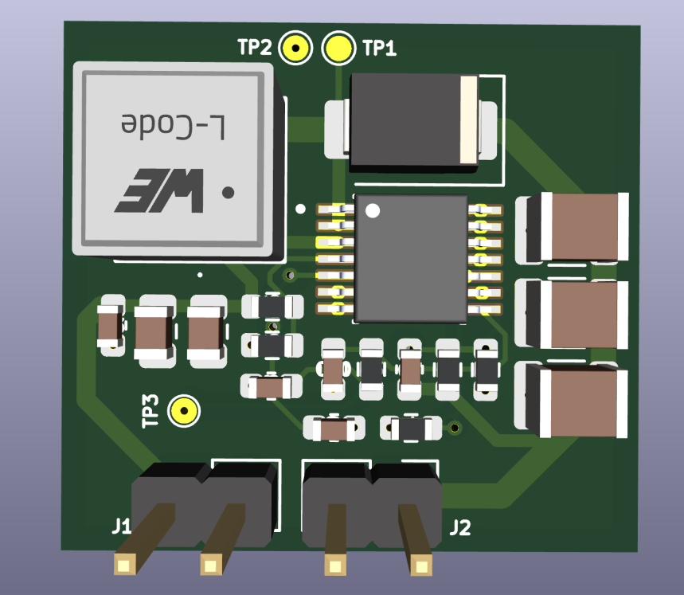
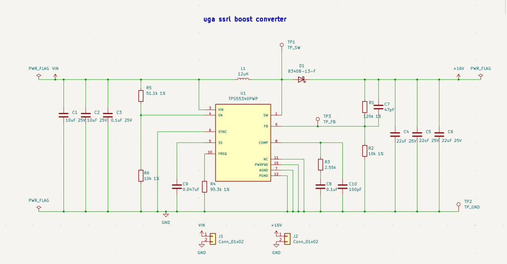
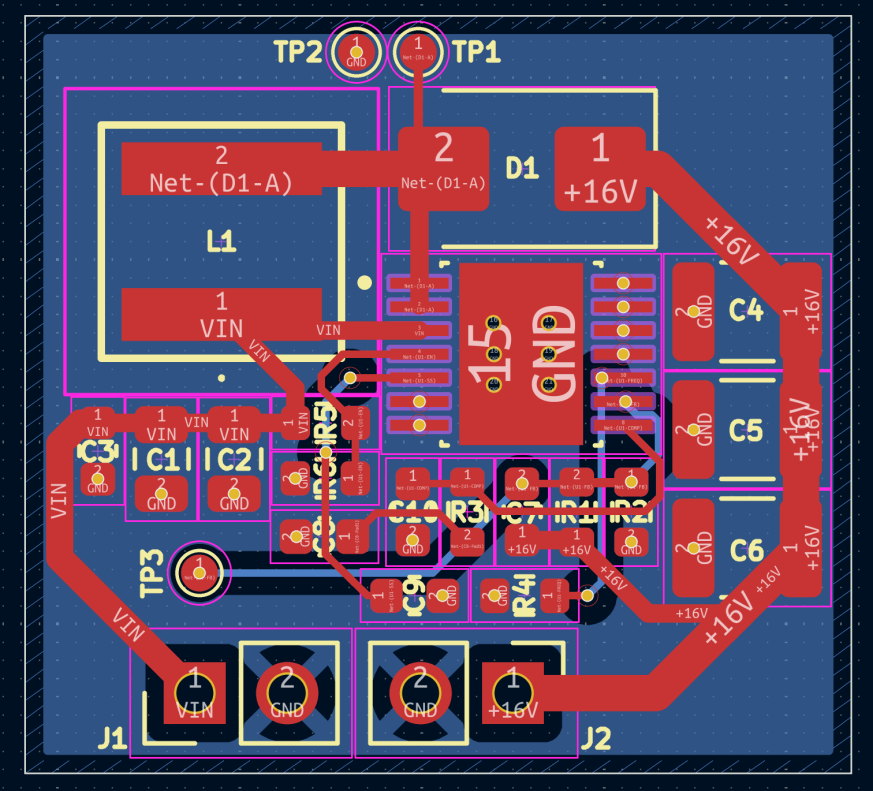
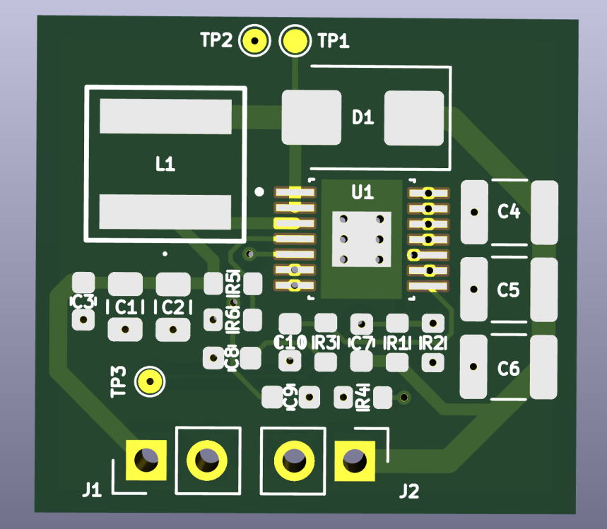

# 16 V Boost Converter for a 2S2P Li-ion Pack

A compact DC-DC boost converter that takes a 2S2P lithium-ion battery pack (7.2 V to 8.4 V) up to a regulated 16 V rail. I designed it as the technical assessment for the hardware team at the UGA Small Satellite Research Laboratory (SSRL), so the design choices lean toward what matters on a CubeSat: small board area, margin on every part, and protecting the battery.



## Specs

| Parameter | Value |
|---|---|
| Input | 7.2 V to 8.4 V (2S2P Li-ion), turn-on near 6.6 V |
| Output | 16 V (15.98 V set point) |
| Output current | 1 A assumed (16 W) |
| Controller | TI TPS55340PWP, HTSSOP-14 with PowerPAD |
| Switching frequency | 500 kHz |
| Duty cycle | 0.49 to 0.56 |
| Peak inductor current | 2.8 A |
| Estimated efficiency | 90% to 92% |
| Calculated output ripple | about 25 mV |
| PCB | 2 layers, 22.7 mm x 20.8 mm |
| Parts cost | about $8.16 per board (qty 1) |

## Design decisions

**Topology.** The input is always below 16 V, so a plain boost is the simplest option that works. I went non-synchronous (Schottky diode instead of a second MOSFET) because at 16 W a synchronous design would add a controller, two FETs, and more board area for a few percent of efficiency.

**Controller.** The TPS55340 has an integrated 5 A / 40 V switch, a 2.9 V to 32 V input range, adjustable frequency, and good TI design support (datasheet equations plus WEBENCH to cross-check). I compared it against the LM2577-ADJ (fixed 52 kHz, needs a much bigger inductor) and a synchronous controller like the LM5122 (more parts and layout complexity).

**Load current.** The assignment didn't give a load current, so I assumed 1 A and designed everything around it. At minimum input the switch and inductor carry about 2.5x the output current, which puts the peak near 2.8 A against the IC's 5.25 A current-limit floor.

**Inductor.** 12 uH Wurth 744393465120, sized for about 30% ripple. I picked it over a Coilcraft XAL8080 and a Bourns SRP1050WA because it had the smallest footprint, a 9.8 A saturation current, and AEC-Q200 qualification.

**Output caps.** Three 22 uF / 25 V X7R 1210 ceramics. Ceramics lose a lot of capacitance under DC bias (each one is closer to 15 uF at 16 V), so three in parallel gives about 45 uF effective and splits the ripple current.

**Feedback.** R1 = 120k, R2 = 10k gives Vout = 1.229 x (1 + 120k/10k) = 15.98 V.

**Battery undervoltage lockout.** The TPS55340's built-in UVLO sits below 3 V, which is way too low for a 2S pack. A boost pulls more current as its input drops, so a dying pack gets pulled down harder. I added a divider on EN (R5 = 51.1k, R6 = 10k) so the converter only runs above about 6.6 V.

**Compensation.** R3, C8, and C10 are starting values from the TI datasheet example. The right-half-plane zero at minimum input puts the crossover limit around 14 kHz, and the final values would come from a measured loop response.

## WEBENCH cross-check

To check my hand calculations, I ran the same specs (7.2 V to 8.4 V in, 16 V at 1 A out) through TI WEBENCH and compared against two TPS55340 designs it generated. WEBENCH picks its own frequency and parts (and used the QFN package), so this is a check on the math, not a copy of my board.

| | My design | WEBENCH design A | WEBENCH design B |
|---|---|---|---|
| Feedback divider | 120k / 10k | 120k / 10k | 120k / 10k |
| Duty cycle | 0.49 to 0.56 | about 0.49 to 0.56 | about 0.49 to 0.56 |
| Switching frequency | 500 kHz | 549 kHz | 779 kHz |
| Frequency resistor | 95.3k | 86.6k | 60.4k |
| Inductor | 12 uH | 10 uH | 6.8 uH |
| Output caps | 3x 22 uF | 2x 22 uF + 1 uF | 3x 4.7 uF |
| Compensation (R / C / C) | 2.55k / 0.1 uF / 100 pF | 976 / 150 nF / 2.7 nF | n/a |
| Efficiency | 90% to 92% (my estimate) | 95% to 96% | 95% to 96% |

What I took from it:

- **The feedback divider and duty cycle match exactly**, so the output setpoint and operating point math checks out.
- **The frequency equation holds.** Plugging 549 kHz into the datasheet equation gives 86.7k, which rounds to WEBENCH's 86.6k. That's the same equation I used to get 95.3k at 500 kHz.
- **The inductor difference comes from frequency, not a mistake.** The same sizing equation gives about 9.6 uH at 549 kHz (so 10 uH works) and about 10.5 uH at 500 kHz (so I rounded up to 12 uH).
- **Frequency barely moved efficiency.** Going from 549 kHz to 779 kHz cut the footprint about 39% with basically the same efficiency curve, which backs up that switching loss is secondary at this power level.
- **I think WEBENCH's efficiency is optimistic.** The Schottky diode alone drops about 0.5 V at 1 A, which is 0.5 W or about 3% of the 16 W output before counting the switch, inductor, or switching losses. I kept my 90% to 92% estimate.
- **For compensation**, I kept the datasheet's worked example values, since those come with documented equations. Either set is a starting point to tune on the bench.

## Schematic



## PCB layout



- Two layers: all parts and almost all routing on top, solid ground pour on the bottom.
- The critical switching loop (SW pins, D1, output caps, back to PGND) is kept under about 1 cm².
- Six thermal vias under the PowerPAD carry heat into the ground plane. This matters more in orbit, where there's no air to carry heat away.
- AGND and PGND join at the PowerPAD. The quiet analog parts return to ground near the IC, away from the switching return.
- No traces or vias under the inductor.
- Test points on the switch node, ground, and FB for bench bring-up.



## Repo contents

```
hardware/      KiCad 9 project (schematic, PCB, project file)
docs/          full design report (PDF) and images
production/    gerbers and BOM
```

The KiCad files open directly. The TPS55340 and Wurth inductor footprints are embedded in the board file.

## Full report

The [design report](docs/Boost_Converter_Design_Report_Aryafar.pdf) covers the full calculations, the inductor trade study, the loss breakdown, and an 11-step bench test procedure. Note that the report lists the board as 22.3 mm wide. The actual outline in the PCB file is 22.7 mm.

## Status and next steps

The design was completed on paper and in KiCad. It hasn't been fabricated yet. Things I'd change for a next revision:

- Finalize the compensation values with a measured loop response
- Add a 0 Ω footprint in series with R1 for loop injection
- Add a load switch so the pack can be fully disconnected at low charge
- Add an input fuse or eFuse for output short protection
- Widen the VIN and switch-node traces, and raise the silkscreen text to the fab minimum
- For flight: TPS55340-Q1, conformal coating, and thermal testing in vacuum

## Tools

KiCad 9, TI WEBENCH, DigiKey and Mouser for part selection.

## Project history

I did this design over about a week in September 2026 for the SSRL assessment and worked on it locally in KiCad without version control. The files here are the final version I submitted, added to GitHub in November 2026 and split into commits by part of the design (schematic, layout, production files, documentation). The only change from the submitted version is a BOM correction listing C1/C2 as X5R, which matches the actual Murata part.
